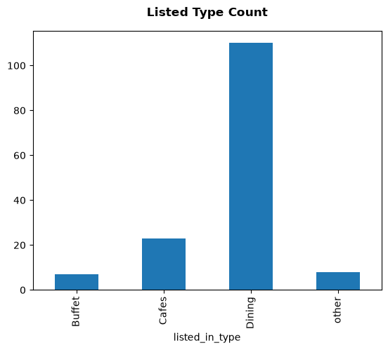
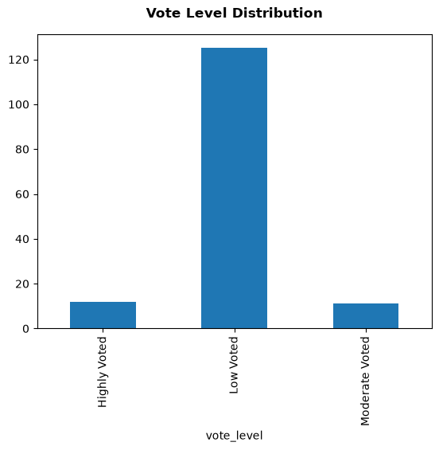
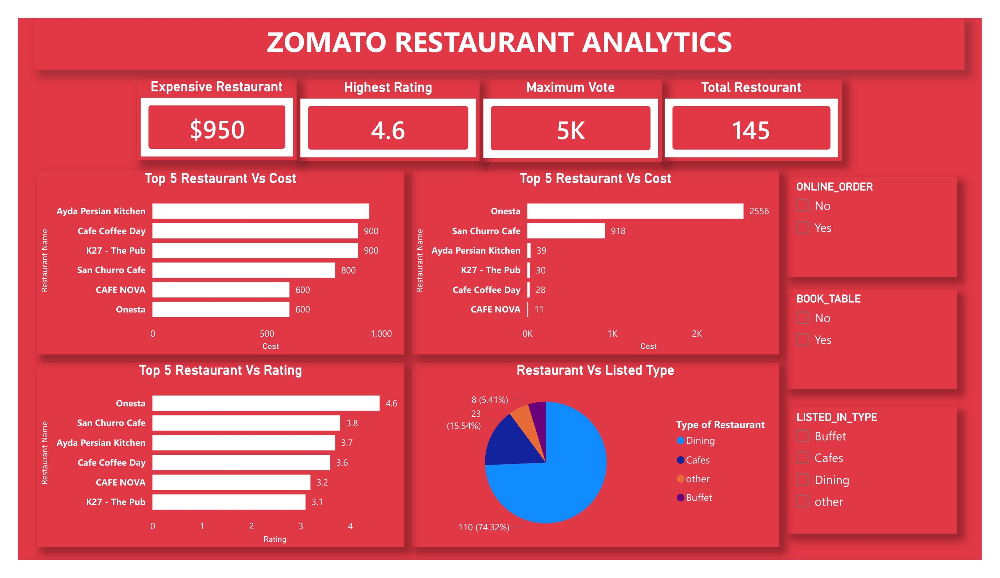
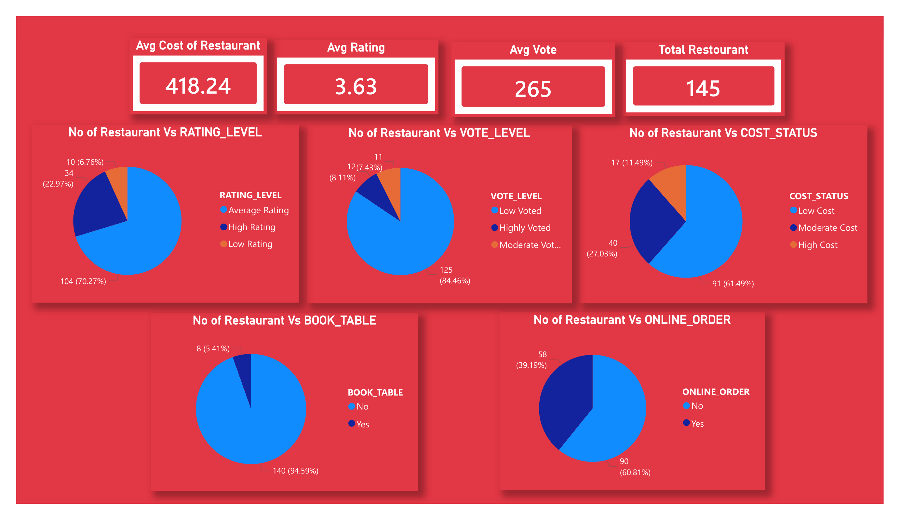

# Zomato Restaurant Analytics

An end-to-end data analytics project that uses **Python, Oracle SQL, and Power BI** to analyze Zomato restaurant data. The project covers data cleaning, exploratory data analysis, business queries, and an interactive dashboard to understand restaurant types, online ordering, table booking, customer ratings, votes, and pricing.

---

## Project Overview

The main goal of this project is to understand restaurant market trends and find useful insights from Zomato restaurant data.

The project follows three main steps:

1. **Python (Pandas):** Cleaned the data, prepared columns for analysis, created categories, and performed exploratory data analysis.
2. **Oracle SQL:** Wrote SQL queries to answer business questions about restaurants, ordering services, ratings, customer votes, and prices.
3. **Power BI:** Created an interactive dashboard with KPIs, charts, and filters to present the results clearly.

This project demonstrates the complete data analytics process, from raw data to business insights.

---

## 🗂️ Dataset

The original dataset, `Zomato.csv`, contains **148 restaurant records**.

### Original Columns

| Column | Description |
|---|---|
| `name` | Name of the restaurant |
| `online_order` | Whether online ordering is available |
| `book_table` | Whether table booking is available |
| `rate` | Restaurant rating stored as text, such as `4.1/5` |
| `votes` | Number of customer votes |
| `approx_cost(for two people)` | Approximate cost for two people |
| `listed_in(type)` | Restaurant category, such as Dining, Cafes, Buffet, or Other |

No missing values or duplicate rows were found in the raw dataset.

### Data Cleaning & Feature Engineering (Python)

I used Python and Pandas to prepare the data for analysis.

- Extracted numeric ratings from the `rate` column and created a `rating` column.
- Standardized column names to make them easier to use in SQL and Power BI.
- Renamed columns such as `votes` to `VOTES`, `approx_cost(for two people)` to `COST`, and `listed_in(type)` to `LISTED_IN_TYPE`.
- Created `cost_status` categories: Low Cost, Moderate Cost, and High Cost.
- Created `rating_level` categories: Low, Average, and High Rating.
- Created `vote_level` categories: Low, Moderate, and Highly Voted.
- Exported the cleaned dataset as `updated_Zomato_data.csv`.
- Prepared the cleaned data for Oracle SQL analysis and Power BI reporting.

---

## Python EDA Highlights

I used charts to understand restaurant distribution, digital services, customer engagement, ratings, and pricing.

| Chart | Key Finding |
|---|---|
| Listed Type Count | Dining is the largest category, with 110 restaurants. |
| Online Order Count | More restaurants do not offer online ordering than those that do. |
| Book Table Count | Approximately 95% of restaurants do not offer table booking. |
| Rating Distribution | Most restaurants fall into the Average Rating category. |
| Vote Level Distribution | Most restaurants receive relatively few customer votes. |
| Cost Status Distribution | Low Cost restaurants form the largest price category. |
| Top 10 Highest Rated | Onesta has the highest reported rating of 4.6. |
| Top 10 Highly Voted | Empire Restaurant and Meghana Foods are among the most voted restaurants. |

### Python Visualizations

<table>
<tr>
<td></td>
<td></td>
</tr>
<tr>
<td></td>
<td></td>
</tr>
<tr>
<td></td>
<td></td>
</tr>
<tr>
<td></td>
<td></td>
</tr>
</table>

---

## SQL Analysis (Oracle) — Business Questions & Solutions

I used Oracle SQL to answer business questions and identify patterns in the restaurant data.

### 1. Restaurant Market Analysis

| Business Question | Finding |
|---|---|
| How many restaurants are listed? | 148 records in the raw dataset; 145 restaurants in the cleaned dashboard dataset. |
| Which restaurant type is most common? | Dining, with 110 restaurants in the raw dataset. |
| Which restaurant type is least common? | Buffet, with 7 restaurants in the raw dataset. |
| What is the distribution of restaurant types? | Dining accounts for approximately 74%, followed by Cafes, Other, and Buffet. |

### 2. Online Ordering Analysis

| Business Question | Finding |
|---|---|
| How many restaurants offer online ordering? | 58 restaurants. |
| How many do not offer online ordering? | 90 restaurants in the raw dataset. |
| What percentage offer online ordering? | Approximately 39.19% of the raw dataset. |
| Which restaurant type has the highest adoption? | SQL queries compare online-ordering adoption across restaurant types. |
| Does online ordering relate to customer engagement? | Average votes and ratings can be compared between restaurants with and without online ordering. |

### 3. Table Booking Analysis

| Business Question | Finding |
|---|---|
| How many restaurants offer table booking? | 8 restaurants. |
| How many do not offer table booking? | 140 restaurants in the raw dataset. |
| What percentage offer table booking? | Approximately 5.41% of the raw dataset. |
| Which restaurant type has the highest adoption? | SQL queries compare table-booking adoption across restaurant types. |
| Does table booking relate to ratings and votes? | Average ratings and votes can be compared between the two groups. |

### 4. Customer Analysis

| Business Question | Finding |
|---|---|
| Which restaurant has the highest number of votes? | Empire Restaurant, with approximately 4,900 votes in the reported analysis. |
| Which restaurant has the highest rating? | Onesta, with a rating of 4.6. |
| Which restaurant type receives the highest average votes? | Compared restaurant types using average customer votes. |
| How do average ratings differ by restaurant type? | Compared average ratings for each category. |
| Which restaurants have high votes but below-average ratings? | Identified restaurants that may need further customer satisfaction analysis. |

### 5. Pricing Analysis

| Business Question | Finding |
|---|---|
| Which restaurant has the highest cost? | Ayda Persian Kitchen, with a reported cost of 950 for two people. |
| What is the average cost by restaurant type? | Compared average prices across restaurant categories. |
| Which restaurant type has the lowest average cost? | Identified by sorting category-level average costs. |
| Does a higher price mean a higher rating? | Compared average costs and ratings to examine the relationship. |
| Does a higher price mean more customer votes? | Compared average costs and votes across restaurant types. |

The SQL analysis uses aggregate functions, filtering, grouping, sorting, and comparative queries to answer these business questions.

**Note:** Some findings above summarize the reported analysis, while other questions describe comparisons performed by the SQL queries. Run `Zomato_SQL_Analysis.sql` against your Oracle database to reproduce the exact results.

---

## 📊 Power BI Dashboard

I created a Power BI dashboard with two pages to present the analysis in an interactive and easy-to-understand format.

### Page 1 — Restaurant Analytics Overview

This page provides an overview of restaurant performance and market distribution.

- **Total Restaurants:** 145
- **Highest Rating:** 4.6 — Onesta
- **Most Expensive Restaurant:** Ayda Persian Kitchen — 950 for two people
- **Maximum Votes:** Displays the highest-voted restaurant and its vote count.
- **Top 5 Restaurants:** Compares restaurants by cost, rating, and votes.
- **Restaurant Type Distribution:** Shows the percentage of Dining, Cafes, Other, and Buffet restaurants.
- **Interactive Filters:** Filter the results by online ordering, table booking, and restaurant type.

### Page 2 — Distribution Analysis

This page focuses on the distribution of restaurant ratings, customer votes, prices, and digital services.

- **Total Restaurants:** 145
- **Average Cost:** 418.24
- **Average Rating:** 3.63
- **Average Votes:** 265
- **Rating Distribution:** Shows the number of restaurants in each rating category.
- **Vote Distribution:** Compares restaurants by customer engagement level.
- **Cost Distribution:** Shows Low Cost, Moderate Cost, and High Cost categories.
- **Online Ordering:** Approximately 39.2% offer online ordering, while 60.8% do not.
- **Table Booking:** Approximately 5.4% offer table booking, while 94.6% do not.

---

## 🔑 Key Insights

The analysis revealed several useful insights about the restaurants in the dataset.

- **Dining dominates the market:** Approximately 74% of the restaurants belong to the Dining category.
- **Online ordering has room to grow:** Only around 39% of the restaurants offer online ordering in the raw dataset.
- **Table booking is uncommon:** Only around 5% of the restaurants provide this service.
- **Most restaurants have average ratings:** The High Rating category contains a smaller share of restaurants.
- **Customer engagement is concentrated:** A small group of restaurants receives a large number of votes.
- **Onesta stands out for its rating:** It has the highest reported rating of 4.6 and a relatively high vote count.
- **Higher prices do not guarantee better performance:** The most expensive restaurant does not automatically have the highest rating or the most votes.
- **Customer feedback can guide improvement:** Restaurants with high votes but below-average ratings can be examined to identify potential service-quality issues.

These findings can help businesses understand restaurant distribution, customer engagement, pricing patterns, and opportunities to improve digital services.

---

## 🧰 Tools & Technologies

| Tool | Purpose |
|---|---|
| **Python** | Data cleaning and analysis |
| **Pandas** | Data manipulation and preparation |
| **NumPy** | Numerical operations |
| **Matplotlib** | Data visualization |
| **Oracle SQL** | Business queries and data analysis |
| **Power BI** | Interactive dashboards and reporting |
| **Jupyter Notebook** | Writing and documenting the analysis |

---

## ✅ Conclusion

This project helped me understand how to turn raw restaurant data into useful business insights.

I used Python to clean and explore the data, Oracle SQL to answer business questions, and Power BI to build an interactive dashboard. The analysis covered restaurant categories, online ordering, table booking, customer ratings, votes, and pricing.

The results show that Dining is the largest restaurant category, online ordering is not yet available at many restaurants, and table booking is relatively uncommon. The analysis also shows that price, ratings, and customer votes do not always move together.

**Overall, this project demonstrates my end-to-end data analytics skills**, including data cleaning, exploratory data analysis, SQL querying, business analysis, and dashboard development.

It also demonstrates how data can be used to identify trends, compare business performance, and support better decisions.
